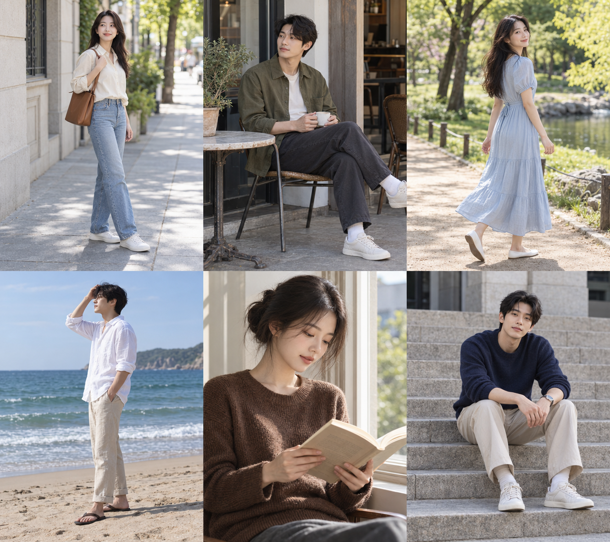

# 日常摆姿参考 · 2026-10-25



使用内置 imagegen 生成，一张三列两行的六格参考图。独立创作，AI 人物，不是抖音截图。已拆分为六张独立图片并接入本机卡片库的「日常摆姿」分类与卡册，刷新项目后自动补充，保留已有卡片编辑与软删除状态。

从左到右、从上到下：

| 位置 | 主题 | 动作与拍摄提示 |
| --- | --- | --- |
| 左上 | 街边扶包带 | 身体侧转，单手轻扶肩带；全身取景，保留脚下空间。 |
| 中上 | 咖啡馆捧杯 | 侧坐并双手捧杯，肩膀放松；斜前方拍摄，注意画面右缘鞋子不要裁断。 |
| 右上 | 公园回眸 | 慢走中轻轻回头；留出行走空间，抓拍裙摆自然变化。 |
| 左下 | 海边理发 | 侧身，一手触碰头发；海平线放平，避免穿过眼睛。 |
| 中下 | 窗边读书 | 双手托书、目光下落；采用半身近景，保留手指和书本。 |
| 右下 | 台阶坐姿 | 双脚自然分开，前臂放在大腿上；稍微前倾，保持颈部舒展。 |

## 抖音检索记录

通过用户指定的 ego-browser 在登录后检索“拍照姿势 日常”。核实作品《十个万能拍照姿势》，作者“一块海绵”，作品 ID `7669329902546345043`。页面标题包含“万能拍照动作”“草地拍照姿势”；截取的播放画面出现“8.叉腰垫脚”。没有完成逐帧核实全部十个动作。

[作品页面](https://www.douyin.com/video/7669329902546345043)

第一组图片在检索完成前生成，因此该作品仅作为后续扩充线索，不能作为上述六个姿势的逐项来源。原始研究截图保存在 output/reference-research-20261025/douyin-reference.png。

## 完整生成提示词

```text
Generate a photorealistic photography posing reference contact sheet for Pose Atlas. Exactly six equal panels, three columns by two rows, each panel portrait 3:4, overall canvas 9:8. No borders, no gutters, no text or watermark. Six different adult East Asian models in tasteful everyday clothes, clearly readable natural body language, correct anatomy and hands. Upper left: woman in cream shirt and blue jeans standing on quiet sidewalk, one hand gently adjusting shoulder bag strap, body three-quarter, weight on back leg, full body including shoes. Upper middle: man in olive overshirt seated sideways on cafe chair, holding ceramic cup with both hands at waist, relaxed shoulders, full seated body and feet. Upper right: woman in pale blue dress in park turning gently back toward camera while walking, arms relaxed, full body and feet. Lower left: man in white linen shirt on beach in profile, one hand brushing hair away in breeze, other down, full body, level horizon. Lower middle: woman in simple brown knit sweater at window, waist-up portrait holding open book at chest, eyes lowered, clear fingers, soft side window light. Lower right: man in navy sweater and beige trousers sitting on wide stone steps, forearms resting loosely on thighs, feet apart, torso slightly forward, full body. Quiet uncluttered real locations, editorial natural skin texture, gentle daylight, consistent realistic muted colors, detailed faces, comfortable poses easily imitated by beginners. These are original AI reference photographs, not recreations of any specific person or creator. High resolution.
```
