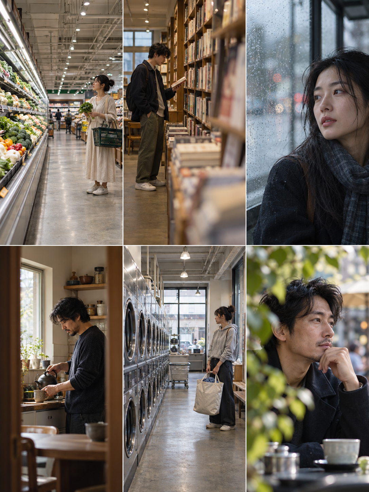
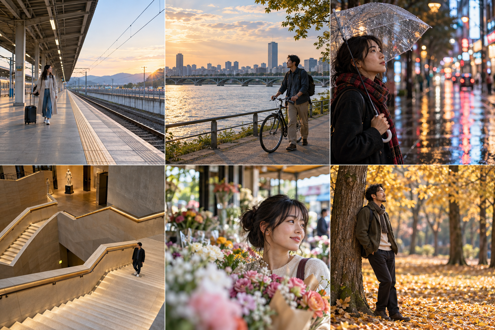
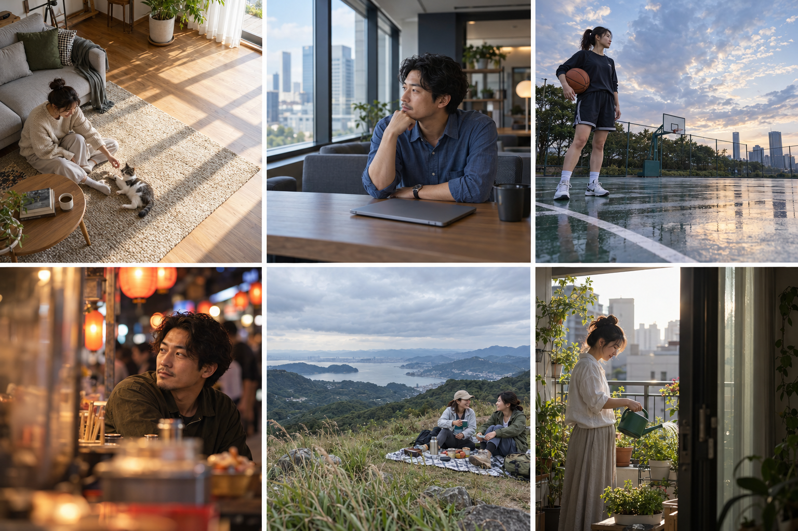

# 常见场景与多焦段参考 · 2026-10-25

本轮使用内置 imagegen 新增三张六格拼图，共 18 个参考画面；加上前一轮共 24 个画面。均为独立 AI 生成，不是抖音作品截图。已拆分成 24 张独立 JPEG，存入 public/images/reference-20261025，并接入本机卡片库的四个分类与卡册；刷新项目后自动补充，不覆盖已有编辑或软删除状态。以下焦距为全画幅等效的拍摄建议与生成意图，不是实拍 EXIF，也不代表模型严格模拟了对应镜头。按现场距离调整机位；透视变化来自机位距离，焦距主要影响视角。

每组均按从左到右、从上到下编号。第一组实际生成的是窄竖幅画面，后两组接近方幅；保留原始输出，不强行拉伸。

## A · 日常空间



| 格 | 场景 | 建议焦段 | 构图、动作与环境 |
| --- | --- | --- | --- |
| 1 | 超市 | 24mm | 人物偏右，提篮选菜；货架作纵深引导，保留卖场环境。 |
| 2 | 书店 | 35mm | 人物偏左，低头翻书；近处书脊遮挡形成前景层次。 |
| 3 | 雨天候车亭 | 85mm | 面部偏右，向左看；雨滴玻璃与远处灯光交代天气。 |
| 4 | 家中厨房 | 50mm | 斜侧面拍倒茶动作，保留手与壶；利用门框和窗光。 |
| 5 | 洗衣店 | 28mm | 人物偏右提衣袋；洗衣机重复圆形与通道延伸空间。 |
| 6 | 露天咖啡座 | 105mm | 托腮近景，前景树叶遮挡；把空白留给视线方向。 |

## B · 城市与旅行



| 格 | 场景 | 建议焦段 | 构图、动作与环境 |
| --- | --- | --- | --- |
| 1 | 火车站台 | 24mm | 人物偏左且占比较小，拉行李；棚顶与站台引导线形成纵深。始终在安全线内。 |
| 2 | 河边步道 | 35mm | 人物与自行车偏右；左侧留河面、桥梁与夕阳。 |
| 3 | 雨夜街头 | 70mm | 人物偏左，持伞半身；右侧湿路面反光形成色彩空间。 |
| 4 | 博物馆楼梯 | 20mm | 高机位俯拍，小人物放在右下；楼梯折线成为画面主体。 |
| 5 | 花市 | 50mm | 花朵在前、中、后景交叠，人物半身；用环境包围人物。 |
| 6 | 秋日公园 | 135mm | 人物偏左轻靠树；较远机位配长焦，叠加秋叶与树干层次。 |

## C · 居家与活动



| 格 | 场景 | 建议焦段 | 构图、动作与环境 |
| --- | --- | --- | --- |
| 1 | 客厅与宠物 | 28mm | 高斜机位，人物坐在左下；右侧大面积地板光影留白。 |
| 2 | 办公休息区 | 50mm | 中景托腮看窗外；桌面形成前景，侧窗提供柔光。 |
| 3 | 篮球场 | 35mm | 低机位全身，人物偏左；球场斜线、天空与雨后倒影形成环境。 |
| 4 | 夜市 | 85mm | 人物偏右，视线向左；暖灯与摊位形成虚化前景。 |
| 5 | 郊外野餐 | 24mm | 双人位于右下，交谈互动；山景和天空占大半画幅。 |
| 6 | 阳台植物 | 70mm | 人物偏左浇水；右侧门框形成框景，植物接住逆光。 |

## 拍摄应用

- 广角环境人像先决定背景与人物占比，让人物远离画面极边缘，避免近距离拉伸脸和四肢。
- 中焦用自然动作连接环境：选书、提篮、倒茶、推车、浇水，比反复摆同一站姿更有变化。
- 中长焦保留必要环境线索，避免每张都只剩没有地点特征的散景。
- 左右三分只是选项；也可使用俯拍、低机位、框景、前景遮挡、负空间和双人关系构图。
- 图像已做目视检查，适合作为构图灵感；模型没有严格实现每格指定的三分位置、人物占比或视线方向，以实际画面为准。

## 完整生成提示词

### A

```text
Create a high resolution photographic posing reference contact sheet for Pose Atlas: exactly 6 equal photographic panels arranged 3 columns and 2 rows, no gutters, no text, no numbers, no watermark. Each panel portrait 3:4. Authentic editorial photography of different adult East Asian women and men in everyday clothing. VARIETY is essential: do not center all subjects, use meaningful environment, varied camera distance, natural believable anatomy. Top left: 24mm wide environmental portrait in a bright supermarket produce aisle, woman holding a shopping basket positioned on RIGHT THIRD, her figure occupies 40 percent of frame height, shelves lead deep into empty left side. Top middle: 35mm medium-full man browsing a bookstore, on LEFT THIRD, foreground blurred books at right, looking at book spine, soft warm interior light. Top right: 85mm close head and shoulders portrait of woman by rainy bus stop glass, face at RIGHT THIRD looking into empty left space, water droplets foreground, soft cool light, no readable signage. Bottom left: 50mm waist-up man preparing tea at home kitchen counter, LEFT THIRD, hands visible with cup, doorway framing, warm window sidelight. Bottom middle: 28mm wide woman at laundromat, standing RIGHT THIRD holding laundry tote, row of circular machines forms strong diagonal, full body small in environmental scene. Bottom right: 105mm tight portrait of adult man at outdoor cafe, LEFT THIRD with thoughtful gaze toward right, leaf bokeh foreground and compressed urban background, believable optical perspective. Cohesive natural muted film-like color, candid moments, realistic skin, no advertising aesthetic. Each photograph independent scene, no collage within a panel. Subject should only be centrally placed when motivated, here follow thirds precisely. Show varied natural posing and environmental storytelling.
```

### B

```text
Generate a premium photorealistic photography reference contact sheet, overall landscape 3:2, exactly 3 columns x 2 rows of six equal square photographs, no text, no watermark, minimal seams. Different adult East Asian men and women, everyday travel clothes. Each panel a completely different camera perspective and setting. Top left: 24mm wide angle environmental scene at a quiet railway platform, woman small at left third pulling suitcase, canopy lines recede to right, full body only 35 percent image height, safe behind platform safety line. Top middle: 35mm eye-level lateral view of man pushing bicycle beside a riverside path, man at right third, river and city occupy left two thirds, warm late afternoon. Top right: 70mm candid waist-up woman looking through umbrella at a rainy night street, placed left third, colorful soft reflections and atmospheric empty space to right, hands clearly readable. Bottom left: 20mm high viewpoint looking down a broad museum staircase, man small in lower-right quadrant, bold zigzag architecture occupies most frame, NOT centered. Bottom middle: 50mm woman at flower market, shoulders and head visible behind soft flowers in foreground, face right third, glance to left, subtle layers, natural daylight. Bottom right: 135mm telephoto feeling of man in autumn park on left third, medium-full body leaning lightly against tree, depth compressed with layered golden foliage, relaxed arms, gentle backlight. Real skin and fabric, believable anatomy, refined documentary photography. Strong variety in person scale, negative space, leading lines, foreground framing and light. No repeated centered standing poses.
```

### C

```text
Photorealistic posing reference sheet: six equal square photos in exactly 3 columns and 2 rows, overall 3:2 landscape. No words, no captions, no watermark. Six distinct everyday settings with adult East Asian subjects, varied ages 25-45, believable natural poses and anatomy. Top left: 28mm wide home living room, woman seated on rug beside sofa playing with small cat, located lower left third, morning sunlight across empty wooden floor right, intimate candid, high oblique camera angle. Top middle: 50mm medium shot in an office lounge, man at right third leaning forearm on table looking toward window left, muted blue shirt, laptop closed, natural thoughtful expression. Top right: 35mm public basketball court after rain, woman in modest sportswear carrying basketball under arm on left third, low camera viewpoint emphasizing painted court diagonal lines and spacious sky right, full body. Bottom left: 85mm shoulder portrait of man at night food market, face on right third, soft warm lantern bokeh left, blurred stall edge foreground, gaze left, no legible signs. Bottom middle: 24mm wide hillside picnic scene, two adult friends sitting diagonally on blanket at right third, foreground grasses lower left, open landscape and overcast sky occupy two thirds, casual interaction rather than looking at camera. Bottom right: 70mm medium profile woman standing on apartment balcony watering potted plants, left third, foreground doorway forms frame at right, soft backlight, hands and watering can clear. Each scene different framing, camera height, focal-length look, light, person scale and negative space. Documentary lifestyle photography, true skin texture, restrained natural color, environment is a storytelling element not just a blurred backdrop. Do not center the person in every panel.
```
